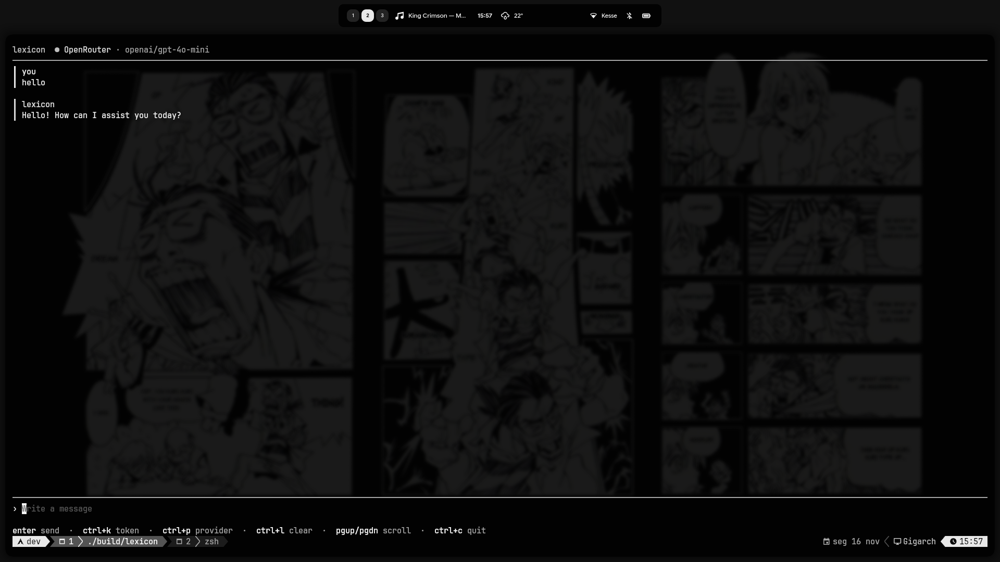
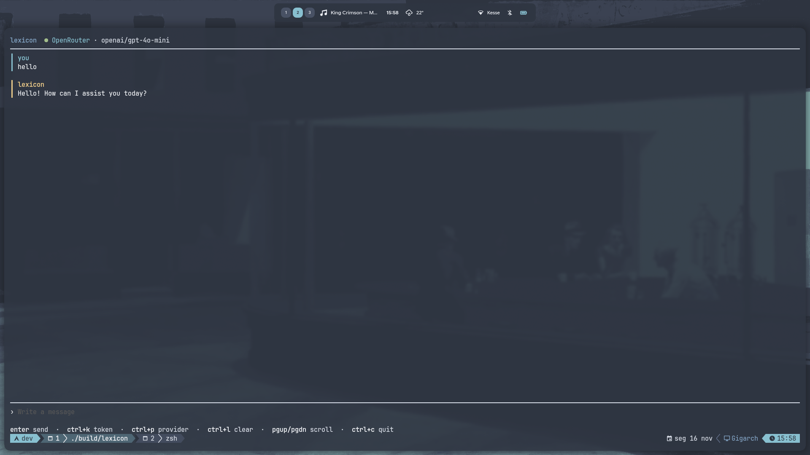

<p align="center">
  
</p>

<h1 align="center">lexicon</h1>

<p align="center">A fast, keyboard-driven AI chat client for your terminal, written in Go.</p>

<p align="center">
  <a href="https://github.com/kristyancarvalho/lexicon/actions/workflows/ci.yml"></a>
  <a href="https://github.com/kristyancarvalho/lexicon/releases"></a>
  <a href="https://aur.archlinux.org/packages/lexicon"></a>
  <a href="go.mod"></a>
  <a href="LICENSE"></a>
</p>

> [!NOTE]
> lexicon is **not** an agent harness. It has no tools, file access or command execution:
> it is a simple chat for quick questions and lookups from your terminal.

## Screenshots

<table>
  <tr>
    <td width="50%"></td>
    <td width="50%"></td>
  </tr>
  <tr>
    <td align="center"><sub>Dark theme</sub></td>
    <td align="center"><sub>Blue theme</sub></td>
  </tr>
</table>

lexicon follows your terminal palette, so it adapts to whatever theme you use.

## Features

- Chat TUI built on [Bubble Tea](https://github.com/charmbracelet/bubbletea)
- Multiple providers: [OpenRouter](https://openrouter.ai) and [Hugging Face](https://huggingface.co)
- Switch provider on the fly, with a per-provider model
- Uses your terminal's own color palette, so it matches any theme
- Tokens are entered inside the app and stored with `0600` permissions
- Single static binary, no CGO

## Installation

### Arch Linux (AUR)

```sh
yay -S lexicon
```

### From source

Requires Go 1.24+ and [Meson](https://mesonbuild.com).

```sh
meson setup build
meson compile -C build
./build/lexicon
```

Or with Go only:

```sh
go build -o lexicon ./cmd/lexicon
```

## Usage

```sh
lexicon [--config <path>] [--version]
```

On first run, press `ctrl+k` to paste the API token for the active provider.
Tokens and the selected provider are saved to `$XDG_CONFIG_HOME/lexicon/config.json`
(usually `~/.config/lexicon/config.json`).

| Provider | Default model |
| --- | --- |
| OpenRouter | `openai/gpt-4o-mini` |
| Hugging Face | `meta-llama/Llama-3.3-70B-Instruct` |

To use a different model, set it in the config file:

```json
{
  "active": "openrouter",
  "models": { "openrouter": "anthropic/claude-sonnet-4" }
}
```

## Keybindings

| Key | Action |
| --- | --- |
| `enter` | send message |
| `ctrl+k` | open token dialog |
| `ctrl+p` | switch provider |
| `ctrl+l` | clear conversation |
| `pgup` / `pgdn` | scroll history |
| `ctrl+c` | quit |

In the token dialog: `enter` saves, `tab` switches provider, `esc` cancels.

## Development

```sh
meson test -C build
```

The suite runs `go test`, `go vet` and a check that the source contains no comments.
Commits follow [Conventional Commits](https://www.conventionalcommits.org).

## Releasing

Pushing a tag like `v0.2.0` creates a GitHub release and publishes the new version
to the AUR. See [`.github/workflows/release.yml`](.github/workflows/release.yml).

## License

[MIT](LICENSE)
